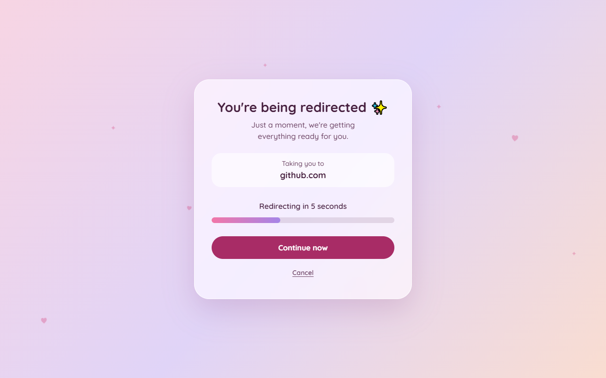
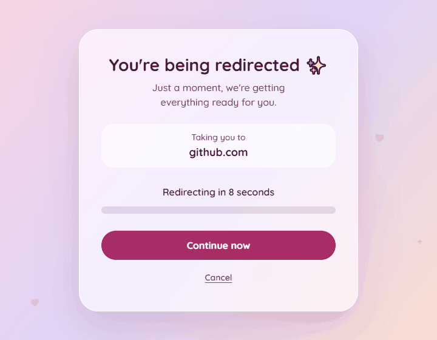

# Redirect Page Template (Girly Edition) ✨

A soft, pastel redirect page that tells visitors where they're going, counts down, then sends them on their way. It's one HTML file with no frameworks and no build step.



## Demo

**[Try the live demo](https://sirine2907.github.io/redirect-page-template-girly/)**. It redirects to my GitHub profile after 8 seconds, unless you press Cancel.



## Features

- Countdown with an animated progress bar, then an automatic redirect
- Shows the destination domain so visitors know where they're going
- "Continue now" button to skip the wait and "Cancel" link to stop it
- Works without JavaScript through a `<noscript>` meta refresh and a plain link
- Pastel palette, animated gradient, glass card and floating hearts and sparkles
- Automatic dark mode in deep plum and rose tones
- Animations turn off for visitors who prefer reduced motion
- Responsive down to small phones
- Accessible: good contrast, visible focus states and `aria-live` on the countdown
- Around 10 KB, and the only external dependency is one Google Font

## Quick Start

1. Download `index.html`, or clone the repo:

   ```bash
   git clone https://github.com/sirine2907/redirect-page-template-girly.git
   ```

2. Set your link in the script at the bottom of `index.html` (see [Configuration](#configuration)).
3. Open the file in a browser to try it, then upload it to any static host.

## Configuration

Both values are at the top of the `<script>` tag in `index.html`:

| Constant       | Default                         | Description                                 |
| -------------- | ------------------------------- | ------------------------------------------- |
| `REDIRECT_URL` | `https://github.com/sirine2907` | Where visitors are sent                     |
| `DURATION`     | `8000`                          | Time before the redirect, in milliseconds   |

```js
const REDIRECT_URL = "https://your-site.com";
const DURATION = 8000;
```

**Also update the no-JavaScript fallback.** It can't read those constants, so change the URL in these two places too:

- the `<meta http-equiv="refresh">` tag in the `<head>` (the `8` in it is the delay in seconds)
- the link inside the `<noscript>` tag in the `<body>`

## Changing the Colors

All colors are CSS custom properties on `:root`, at the top of the `<style>` tag:

```css
:root {
  --blush: #fbd5e0;
  --lavender: #e0d4f7;
  --peach: #ffdfc8;
  --cream: #fff8f0;
  --bar-start: #f276a8;
  --bar-end: #a585e8;
  --button: #a82c66;
}
```

The first four set the background gradient, `--bar-start` and `--bar-end` set the progress bar, and `--button` sets the main button. Dark mode has its own values in the `@media (prefers-color-scheme: dark)` block, so change those too.

## Deploy on GitHub Pages

1. Push `index.html` to a public GitHub repository.
2. Go to **Settings → Pages**.
3. Under **Source**, choose **Deploy from a branch**.
4. Select the `main` branch and the `/ (root)` folder, then press **Save**.
5. After a minute or so, your page is live at `https://<your-username>.github.io/<repo-name>/`.

## License

[MIT](LICENSE) © 2026 Sirine Ayadi
